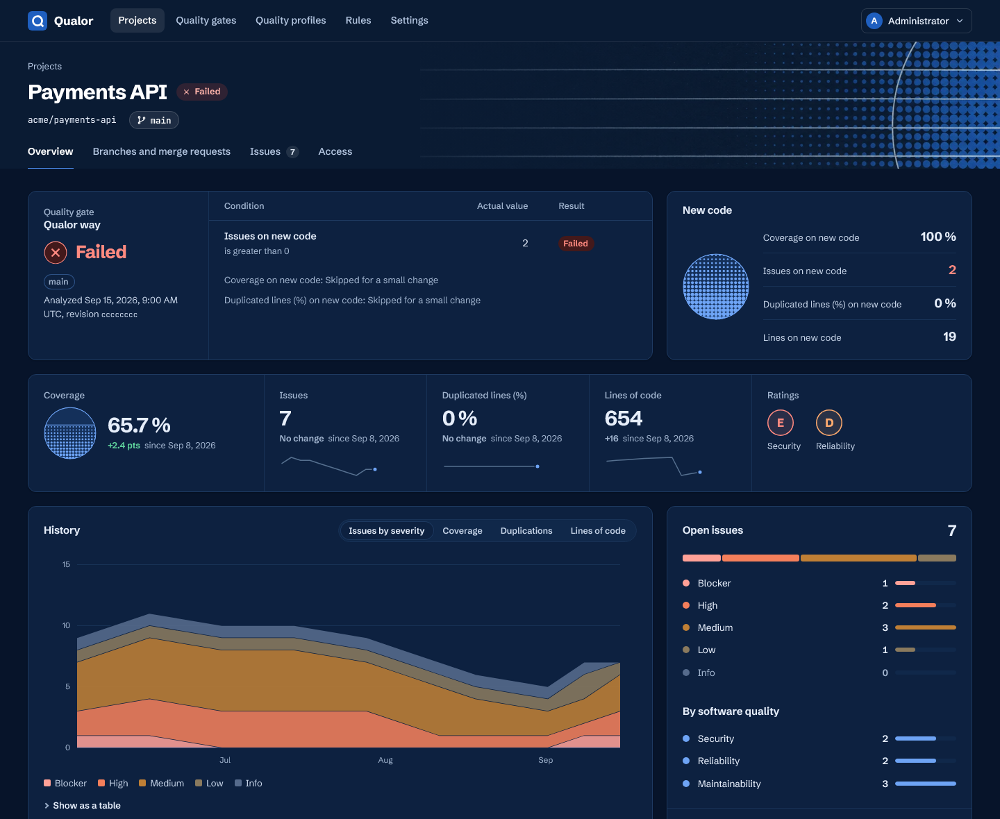
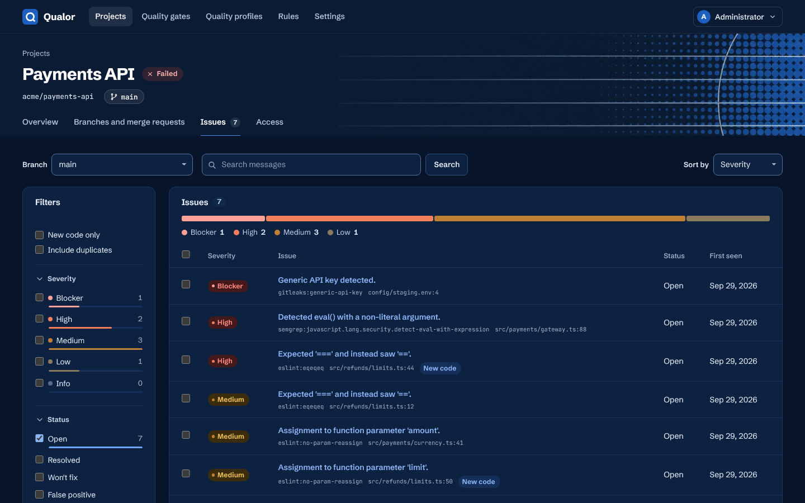
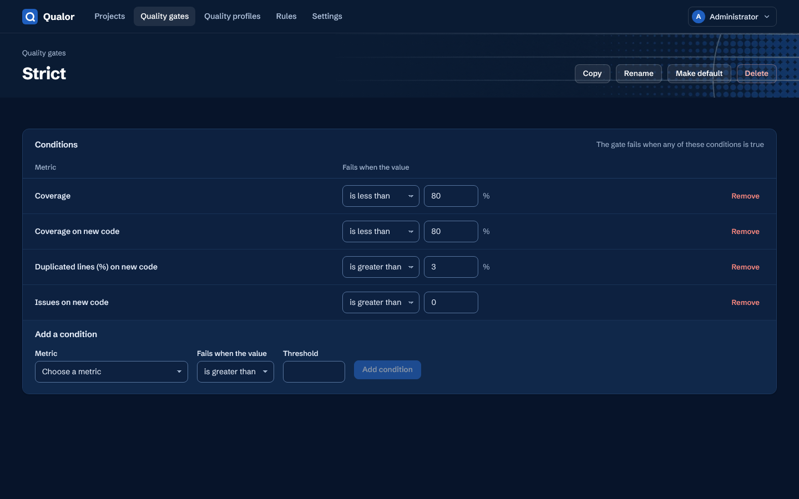

# Qualor

**Static analysis and AI code review in one self-hosted server.** Qualor runs proven open-source
analyzers in your CI, applies a quality gate to new code, and comments on GitLab merge requests and
GitHub pull requests. A model of your choice can review the same merge requests. It is free, with
no lines-of-code licence.

[Documentation](https://qualor.dev/docs) · [Live demo](https://review.qualor.dev) ·
[Docker Hub](https://hub.docker.com/u/qualor) ·
[GitLab CI/CD component](https://gitlab.com/qualor/qualor) ·
[GitHub Action](https://github.com/qualor-dev/scan-action)

<p align="center">
  
</p>

<table>
  <tr>
    <td width="50%" valign="top">
      
      <br><sub><b>AI review</b> on a pull request, with a suggested change</sub>
    </td>
    <td width="50%" valign="top">
      
      <br><sub><b>The finding in Qualor</b>, beside the analyzers' issues</sub>
    </td>
  </tr>
  <tr>
    <td width="50%" valign="top">
      
      <br><sub><b>Issues</b>, filtered by severity, status, quality and rule</sub>
    </td>
    <td width="50%" valign="top">
      
      <br><sub><b>A quality gate</b> and its conditions</sub>
    </td>
  </tr>
</table>

The live demo is Qualor analysing its own code. Click **Explore the demo** on the sign-in page: no
account needed.

## What you get

- **A quality gate on new code.** Issues, coverage, duplication and complexity are tracked across
  commits. The gate judges only what a change adds, and a failed gate fails the CI job.
- **The analyzers you already know**, pinned in one scanner image (see [Languages](#languages)).
- **Qualor's own security rules** for JavaScript, TypeScript, Python, Java, Go and C#. They follow
  request data into SQL, shell commands, file paths, templates, redirects and outgoing requests.
- **Merge request comments** on GitLab and GitHub: a summary, a thread on each new issue, and a
  commit status or check run.
- **AI review** on your own model: threads with suggested changes, answers to replies, and
  re-reviews after a push. Off by default, in every edition.
- **An AI assistant** that explains an issue, suggests triage or suggests a fix, on a person's click.
- **An MCP server**, so agents such as Claude Code and Cursor can read the gate and the issues.
- **SonarQube import**: quality gates, profiles and issue statuses.

## Quick start

You need Docker with Compose v2. Save the compose file from
[Install the server](docs/guide/install-server.md#the-compose-file) as `compose.yml` in an empty
directory, then:

```sh
umask 077
cat > .env <<EOF
QUALOR_VERSION=0.13
QUALOR_SECRET_KEY=$(openssl rand -hex 32)
QUALOR_BOOTSTRAP_ADMIN_PASSWORD=$(openssl rand -hex 16)
EOF
docker compose up -d
docker compose ps          # wait until the server is "healthy"
```

Open <http://127.0.0.1:8080>, sign in as `admin` with the password from `.env`, and change it. The
server is one container with its own PostgreSQL. For TLS, backups, upgrades and Kubernetes, see
[Install the server](docs/guide/install-server.md).

Then create a project and a CI token: see [Quick start](docs/guide/quick-start.md).

## Scan in CI

Set `QUALOR_URL` and `QUALOR_TOKEN` (masked) as CI variables. The scanner image is
`qualor/scanner:<tag>`, for example `0.13` or `0.13.0`.

**GitLab**, with the CI/CD component:

```yaml
include:
  - component: gitlab.com/qualor/qualor/qualor@<version>
    inputs: { image-tag: <tag> }
```

The job runs in merge request pipelines and on the default branch. It also writes GitLab's Code
Quality report, which works on every tier, and the SAST and Dependency Scanning reports, which
GitLab shows on GitLab Ultimate only. A self-managed GitLab needs its own copy of the component.
See [GitLab](docs/guide/gitlab.md).

**GitHub Actions**, with the Qualor Action:

```yaml
- uses: actions/checkout@v4
  with:
    fetch-depth: 0
    persist-credentials: false
    ref: '${{ github.event.pull_request.head.sha || github.sha }}'
- uses: qualor-dev/scan-action@v0.13
  with:
    server-url: '${{ vars.QUALOR_URL }}'
    token: '${{ secrets.QUALOR_TOKEN }}'
```

See [GitHub](docs/guide/github.md) for the whole workflow and the GitHub App that posts check runs
and review comments.

**Other CI systems** run the scanner image with `qualor scan`: see
[Other CI systems](docs/guide/other-ci.md).

Run the scan from the repository root, in a full clone. An optional `qualor.yml` there configures
it; see the [configuration reference](docs/guide/configuration.md).

## Languages

| Language               | Analyzers                                                                                    |
| ---------------------- | -------------------------------------------------------------------------------------------- |
| JavaScript, TypeScript | ESLint, SonarQube-compatible rules (eslint-plugin-sonarjs), Qualor security rules            |
| Java                   | PMD, SpotBugs with FindSecBugs, Qualor security rules                                        |
| Kotlin                 | detekt                                                                                       |
| Swift                  | SwiftLint                                                                                    |
| C#                     | Roslyn, Roslynator, SonarQube-compatible rules (SonarAnalyzer.CSharp), Qualor security rules |
| Python                 | Ruff, Qualor security rules                                                                  |
| PHP                    | PHPStan                                                                                      |
| Ruby                   | RuboCop                                                                                      |
| Go                     | staticcheck, go vet, gosec, Qualor security rules                                            |
| C, C++                 | cppcheck; clang-tidy when your job has it                                                    |
| CSS, HTML              | stylelint, HTMLHint                                                                          |
| Every language         | OpenGrep, Gitleaks for secrets, Trivy for dependencies, any SARIF file                       |

Some analyzers need the project prepared first: installed `node_modules` for ESLint, compiled
classes for SpotBugs, downloaded Go modules. C# runs inside your own build with the
`qualor/scanner-dotnet` image. See [Languages and analyzers](docs/guide/languages-and-analyzers.md).

## AI review

A model reviews GitLab merge requests and GitHub pull requests on the projects you choose. It reads
the change and any file of the repository it needs, and it is told what the analyzers already
found.

- It comments in threads on the changed lines, with suggested changes a person applies in one
  click.
- It answers replies in its threads. A `qualor review` comment asks for a review.
- After a push, only new changes get new findings, and fixed findings close.
- AI findings never count in the quality gate. The model never approves and never commits.

Use any OpenAI-compatible endpoint, OpenAI's Responses API or the Anthropic Messages API, hosted
with your key or running locally. Secrets are masked before anything is sent, and with a local
model nothing leaves your network. See [AI review](docs/guide/ai-review.md) and the
[AI assistant](docs/guide/ai-assistant.md).

## Migrating from SonarQube

`qualor import sonarqube` copies the quality gates, quality profiles and issue statuses of a
SonarQube Server or SonarQube Cloud organisation. It only reads from SonarQube, and `--dry-run`
shows what would change. See [Migrating from SonarQube](docs/guide/migrate-from-sonarqube.md).

## Editions

Everything above is free, with no limit on lines of code, users or projects. The code is
MIT-licensed, and Qualor's security rules are source-available. A Business or Enterprise licence key
adds single sign-on, SCIM, the audit log, compliance and
portfolio reports, a dependency licence policy and automatic fix suggestions. That code lives in
`enterprise/`, under the source-available Qualor Enterprise Licence, and does nothing without a
key. See [Enterprise](docs/guide/enterprise.md) and [qualor.dev/enterprise](https://qualor.dev/enterprise).

## Documentation

The guide is in [docs/guide/](docs/guide/README.md), on [qualor.dev/docs](https://qualor.dev/docs),
and under **Docs** on every Qualor server. It also has [ready-made prompts](docs/guide/ai-prompts.md)
that let an AI agent roll Qualor out for you.

## Contributing and security

See [CONTRIBUTING.md](CONTRIBUTING.md) for setup, commands and the DCO sign-off every commit needs.
Report vulnerabilities privately to security@qualor.dev, never in a public issue: see
[SECURITY.md](SECURITY.md).

## Trademarks

SonarQube and SonarCloud are trademarks of SonarSource SA. Qualor is an independent project and is
not affiliated with, sponsored or endorsed by SonarSource. Their names are used only to describe
compatibility and to compare features.
